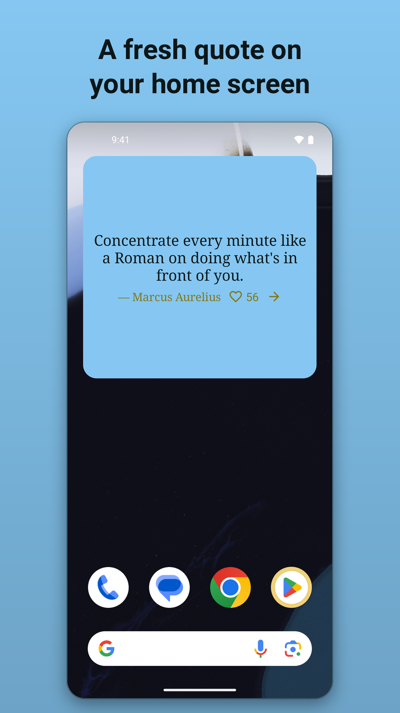
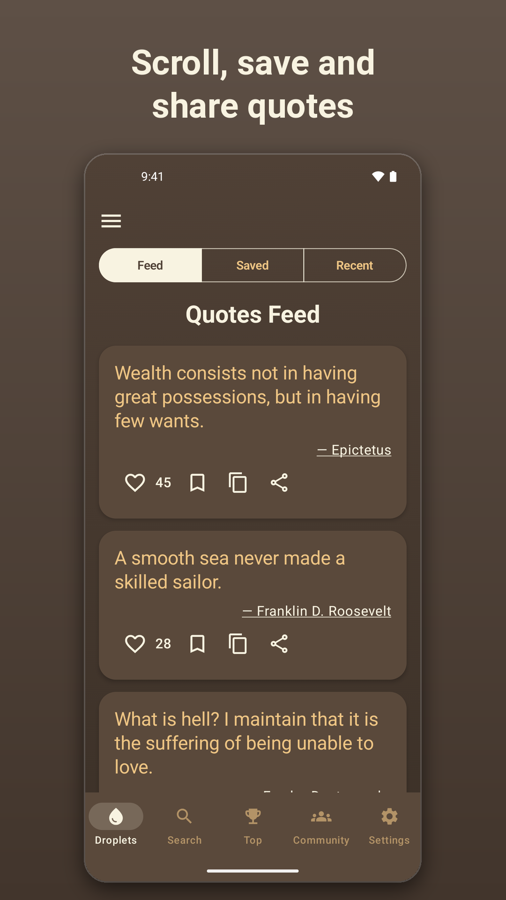
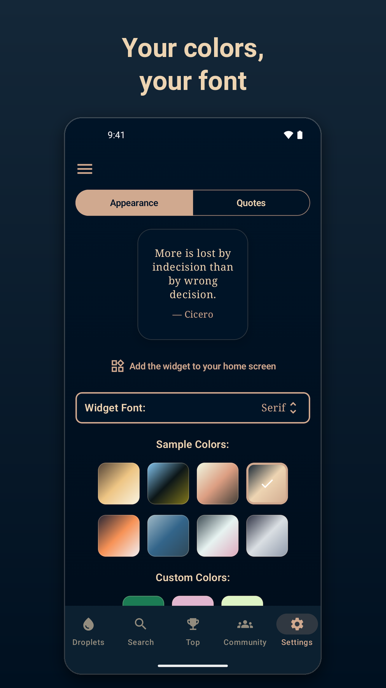
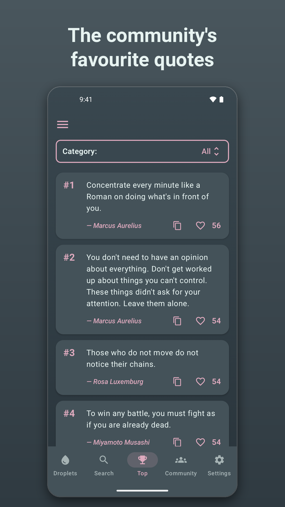

# Quote Droplet for Android

A fresh quote on your home screen. The Android version of
[Quote Droplet](https://apps.apple.com/app/id6455084603) (iPhone and Mac), built with Kotlin and
Jetpack Compose. It talks to the same backend as the iOS app.

<p>
  
  
  
  
</p>

## Features

- **Home screen widget** (Glance): resizable, with like and next-quote buttons on the larger sizes.
  Refreshes every 8 hours to once a week, using WorkManager.
- **Daily notification** at a time you pick, with the iOS app's water-drop sound. Re-armed after
  reboots, time changes and app updates.
- **Droplets**: a quotes feed with pull to refresh, plus Saved and Recent (quotes you've seen on the
  widget or in a notification).
- **Search** by quote text or author, filtered by category, with matches highlighted.
- **Top**: the most-liked quotes, by category.
- **Community**: the newest approved quotes, quote submission, and the status of your submissions.
- **Settings**: 8 palettes plus custom colors (they theme the whole app, not just the widget),
  9 fonts, quote category and refresh frequency.
- Works offline for the widget and notifications, using a bundled backup of the quotes.

## Project layout

```
app/src/main/java/com/danielagapov/quotedroplet/
  data/           API (Retrofit + kotlinx.serialization), repository, local stores
  notifications/  daily notification scheduling and receivers
  widget/         Glance widget, its actions and the refresh worker
  ui/             Compose screens (droplets, search, top, community, settings, info, author)
store/            Play listing text, icon, feature graphic and screenshots
tools/            scripts that generate the icons and store graphics from the iOS icon
```

## Building

Needs JDK 17 and the Android SDK (compile/target SDK 36, min SDK 26).

```
./gradlew :app:installDebug          # debug build on a device or emulator
./gradlew :app:testDebugUnitTest     # unit tests
./gradlew :app:bundleRelease         # signed release bundle for Play
```

Release signing reads `keystore.properties` in the project root, which is never committed:

```
storeFile=/absolute/path/to/upload-keystore.jks
storePassword=...
keyAlias=upload
keyPassword=...
```

Without it, release builds are unsigned.

## License

Copyright 2026, Daniel Agapov. All rights reserved. See [LICENSE.md](LICENSE.md).
